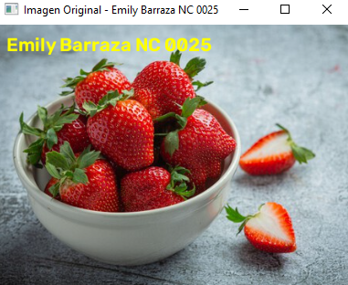
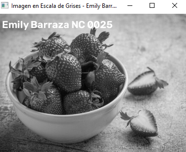
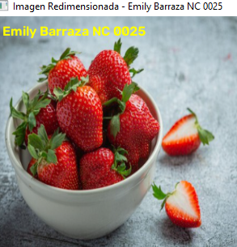
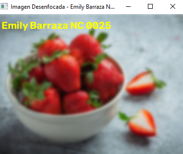
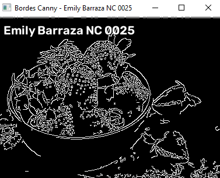
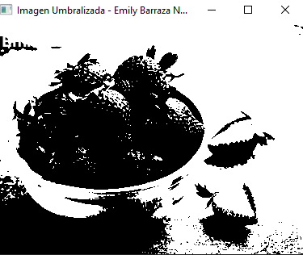
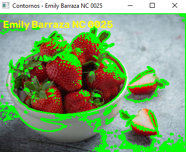
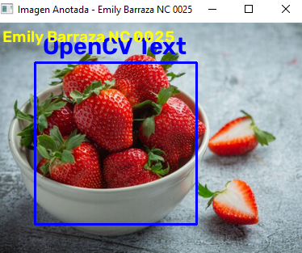

## operaciones basicas con open cv
## Alumno Emily Barraza NC = 0025

## Imagen original

## Imagen escala de grises

## Imagen redimensionada

## Imagen desenfocada 

## Imagen bordes canny

## Imagen ubralizada

## Imagen contornos

## Imagen con cuadrado y texto

